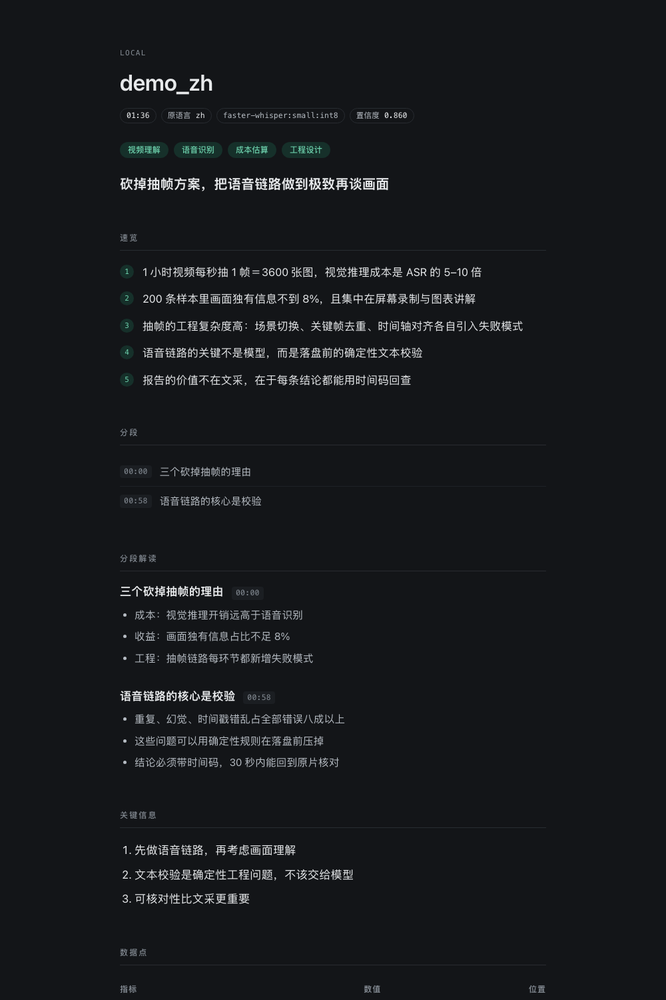

# LinkDigest

媒体链接 → 结构化内容总结报告。**采集、转写、清洗全部本地开源，理解层交给模型（或任意 agent）。**

[](pyproject.toml)
[](LICENSE)
[](docs/ARCHITECTURE.md)



粘一个视频、播客、文章链接（或直接传文件），拿到一份报告：一句话概括、章节解读、关键信息、
数据点、原话引用、争议与未解问题——**每个结论后面都有时间码，三十秒内能回原片确认**。

---

## 设计取舍

不做「全都要」的媒体分析器，只把一条链路做到可核对：

- **不抓视频帧。** 视频只取音轨做 ASR。抽帧 + 视觉推理的成本是语音链路的 5-10 倍，
  而画面独有信息占比极低。这条结论来自实验，不是偏好，理由在 [ARCHITECTURE.md](docs/ARCHITECTURE.md)。
- **不设独立翻译阶段。** 让模型在总结时直接跨语言读原文，避免两次误差叠加。
- **不追求「有报告」。** 拿不到音轨就报错并说明下一步，不拿简介或试听凑一份看着像样的假报告。
- **不做交互式 UI 渲染。** 输出 Markdown + 结构化 JSON：前者给人看，后者给程序用。

## 快速开始

需要 Python ≥ 3.10 和 ffmpeg（`FFMPEG_BIN` 可指定路径）。

```bash
git clone https://github.com/Chrissish/linkdigest.git && cd linkdigest
./scripts/setup.sh          # 建 venv、装依赖（可重复执行）
cp .env.example .env        # 填 LLM_API_KEY；不填也能跑，报告降级为抽取式

# 命令行
.venv/bin/python -m linkdigest.cli "https://www.bilibili.com/video/BVxxxx" --show
.venv/bin/python -m linkdigest.cli ./lecture.m4a --show

# 网页
./scripts/run.sh            # http://127.0.0.1:8787
```

首次运行会下载 Whisper 模型（默认 `small`，约 460MB；`large-v3` 是 1.5GB，慢 3-5 倍但准得多）。
国内网络建议 `export HF_ENDPOINT=https://hf-mirror.com`。

## 支持范围

| 类型 | 路径 | 稳定性 |
| --- | --- | --- |
| YouTube / B站 / Vimeo / X / TikTok / 快手 / 微博 | yt-dlp 取音轨 | 稳 |
| Spotify / Apple Podcasts 单集 | 页面元数据 → 反查原始 RSS → 取 enclosure | 稳（独家节目除外） |
| 播客 RSS / 小宇宙 / 喜马拉雅 | feedparser，或从页面捞直链 | 稳 |
| 公众号 / 知乎 / 普通文章 | trafilatura 抽正文 + 可选 OCR | 稳 |
| 抖音 / 小红书 | yt-dlp（需 cookies） | 脆，随时坏 |
| 本地音视频 / 文本 | 直接进管道 | 稳 |
| 音乐（Spotify / Apple Music / 网易云 / QQ 音乐） | 不支持 | 永久——DRM 加密 |

**播客能解析、音乐不能**，原因不是技术难度，是音源所有权：播客生态里平台只是分发渠道，
RSS 才是源头，同一集的 mp3 在节目自己的 feed 里有公开的 `<enclosure>` 直链；音乐没有。
所以播客走「单集页面 → oEmbed / iTunes Lookup 拿元数据 → 反查 RSS → 标题模糊匹配
（`SequenceMatcher`，阈值 0.72）→ enclosure」，两跳都失败才报错。
Spotify 独家节目没有公开 RSS，属于死角，会直接提示上传音频。

## 产物

```
data/jobs/INDEX.md                        全部任务的可读索引（标题 / 平台 / 状态 / 源）
data/jobs/20261116-2248_youtube_<标题>_412be41ee3a6/
  manifest.json     这一条内容的身份证（标题 / 平台 / 源链接 / 模式）
  transcript.json   契约（下游唯一输入，schema 见 schemas/）
  report.md         文本版：带 frontmatter，进版本库、进 Obsidian
  report.html       单文件网页版：样式全内联，可打印、可转发
  report.json       结构化报告，给程序用
  usage.json        token / 成本 / 阶段耗时
  stages.jsonl      阶段日志
  handoff/          没有模型密钥时的交接包（BRIEF.md + answer.json）
```

目录名可读（`时间_平台_标题_job_id`），末尾是 job_id，命令里用完整 id、前缀或目录名片段都能定位：

```bash
python -m linkdigest.cli --list                # 所有任务
python -m linkdigest.cli 412be41e --show       # 前缀即可
python -m linkdigest.cli --prune-failed        # 清掉失败任务（移入废纸篓，可恢复）
```

报告的三种形态、契约的三层结构、frontmatter 字段，见 [docs/REPORT-FORMAT.md](docs/REPORT-FORMAT.md)。

## 不配模型密钥也能用

确定性层（下载 → 抽音轨 → ASR → 清洗 → 契约）跑完后，如果没有 `LLM_API_KEY`，
管道会额外写一份 `handoff/`，把「理解与归纳」交给任意一个会读文件的 agent——
本机会话、编辑器里的助手、浏览器对话都行：

```bash
python -m linkdigest.cli "https://www.youtube.com/watch?v=xxxx"   # → handoff/BRIEF.md
# 把 BRIEF.md 丢给 agent，让它按契约写 handoff/answer.json
python -m linkdigest.cli 412be41e --apply                          # 校验 → 渲染 → 完成
```

`BRIEF.md` 只是文本，不绑定任何厂商。网页上会显示「理解层待外部完成」的黄条，
带「复制作业单 / 查看作业单 / 应用 answer.json」三个按钮；也可以走
`POST /api/jobs/{id}/apply` 带 `{"answer": {...}}` 直接提交。

## 配置

全部通过环境变量或 `.env` 覆盖，无配置中心。完整清单见 `.env.example`。

| 变量 | 作用 | 默认 |
| --- | --- | --- |
| `LLM_API_KEY` | 理解层密钥，留空则降级 | 空 |
| `LLM_BASE_URL` / `LLM_MODEL` | 任意 OpenAI 兼容端点 | `api.openai.com/v1` / `gpt-4o-mini` |
| `ASR_MODEL` | 精度 / 速度取舍 | `small` |
| `ASR_MAX_SECONDS` | 单条时长上限 | 4 小时 |
| `LLM_CHUNK_CHARS` | map-reduce 分块大小 | 6000 |
| `COOKIES_FILE` / `COOKIES_FROM_BROWSER` | 登录态来源 | 空（默认读 `data/cookies.txt`） |
| `PROXY_URL` | 钉死出口；留空则直连 → 环境变量 → 系统代理自动探测 | 空 |
| `MAX_DOWNLOAD_MB` | 下载体积上限 | 2048 |

ASR 引擎默认 `auto`：装了 `faster-whisper` 就用它，Apple Silicon 上装 `mlx-whisper` 会更快。
OCR 与 mlx 都是可选依赖：

```bash
pip install -e ".[ocr]"      # 图文源 OCR
pip install -e ".[mlx]"      # Apple Silicon 加速
```

## 架构

```
链接 / 文件 → 采集（yt-dlp / RSS / 正文抽取）
           → 抽音轨（ffmpeg）→ ASR（Whisper）→ 清洗（确定性规则）
           → 契约 transcript.json
           → 理解（模型 map-reduce，或外部 agent）
           → report.md / report.html / report.json
```

分界线在**契约**：前一半是确定性的、可自检的、不需要网络的工程；后一半是概率性的、
可替换的理解。所以换模型、换 agent、甚至不接模型，前半段的结论都成立。

- 分层与各层职责：[docs/ARCHITECTURE.md](docs/ARCHITECTURE.md)
- 取舍细节与待办：[docs/DETAILED-DESIGN.md](docs/DETAILED-DESIGN.md)
- 契约定义：[schemas/transcript_bundle.schema.json](schemas/transcript_bundle.schema.json)

### 目录

```
src/linkdigest/          管道本体（采集 → ASR → 契约 → 理解 → 报告）
web/                     网页界面（单页，由 API 直接托管）
scripts/                 安装/启动、cookies 工具、自检与重渲染等运维脚本
schemas/                 契约 JSON Schema
docs/                    架构、排错、cookies、报告格式
tests/fixtures/          回归样本：产物快照 + samples/ 里的自检输入
data/                    运行时产出（已 gitignore）
```

## 常见问题

| 症状 | 去哪看 |
| --- | --- |
| 网页双击打开是白页 / 点「生成总结」没反应 | [TROUBLESHOOTING.md](docs/TROUBLESHOOTING.md#网页打不开--点了没反应) |
| `Sign in to confirm you're not a bot` | [COOKIES.md](docs/COOKIES.md) |
| 代理 502 / 连接超时 | [TROUBLESHOOTING.md](docs/TROUBLESHOOTING.md#代理的坑) |
| 各类报错的中文含义 | [TROUBLESHOOTING.md](docs/TROUBLESHOOTING.md#报错对照表) |

## 已知限制

- **默认单机、单进程。** 任务在进程内的线程池里跑，没有队列也没有恢复机制；进程挂了任务要重跑。
- **长音频吃 CPU。** `small` 在 M 系列 CPU 上约 6 倍实时；1 小时播客要十几分钟，GPU 会快很多。
- **抖快红是脆的。** 平台随时改，靠 cookies 勉强维持，坏了不奇怪。
- **模型质量取决于你接的模型。** 降级模式只保证结构，不保证归纳。

实测基线（96s 中文音频 / `ASR_MODEL=small` / M 系列 CPU）：
抽音轨 0.08s → ASR 15.5s（≈6 倍实时）→ 清洗落盘 0.03s。

## 合规

这是一个个人研究 / 学习工具：**只处理你有权访问的内容，遵守目标平台的服务条款与当地版权法。**
不要用它做批量抓取、内容再分发或商业转载。作者不对使用者的行为负责。

## 参与贡献

欢迎 issue 和 PR，尤其是「某平台又坏了」这类实测反馈。改动前先跑一遍自检：

```bash
.venv/bin/python scripts/selftest.py     # 只碰确定性层，不需要网络与模型密钥
```

## License

[MIT](LICENSE)
