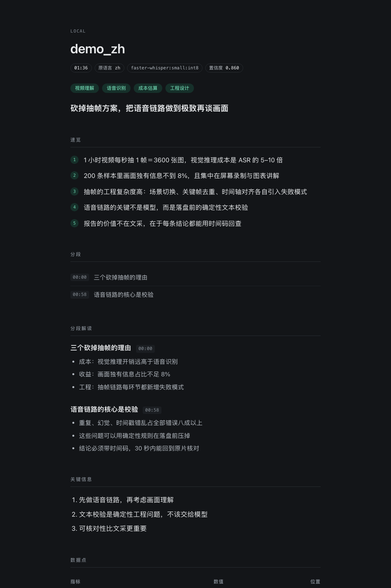

# 报告与契约

同一份 `Report` 对象、同一个落盘入口，产出三种形态。三者不会各说各话——HTML 版不新增任何内容，
只做排版取舍。

| 文件 | 给谁 | 特点 |
| --- | --- | --- |
| `report.md` | 终端、版本库、diff、agent、Obsidian | 顶部 YAML frontmatter，可直接进知识库 |
| `report.html` | 人 | 单文件、样式全内联（离线可看、不依赖 CDN），可直接打印成 PDF |
| `report.json` | 程序 | 结构化，字段见 `schemas/` |



## 契约分三层，别混着看

作业单把「要求」和「建议」分开放，避免把配额当成标准：

| 层 | 内容 | 破了的后果 |
| --- | --- | --- |
| **必填** | `one_liner`（一句话）、`tags`（≤5 个内容标签词）、`sections`（含 `start`/`end` 时间码锚点）、`body`（自由 Markdown 正文）、`intent`（给谁看，可空） | 渲染不出报告，或报告无法逐节回查 |
| **不可违反** | 只用正文信息、中文输出、时间码真实存在、矛盾不裁决、答案落盘 | 内容不可核对，等于没读 |
| **可选** | `tldr` / `key_points` / `data_points` / `quotes` / `controversies` / `open_questions` / `terms` / `appendix` | 没有影响，留空或不写都合法 |

`body` 是整份产出里最值钱的部分：长度由内容决定，不设上限，也不要求分点。
`appendix` 装通用字段装不下的形状（时间线、代码、人物表、对照表），自带 `###` 标题。

渲染顺序是**标签 → 一句话总结 → 速览 → 正文 → 分段解读 → 关键信息 → 数据点 → 原话 →
存疑 → 术语 → 附录**：最前面给你「这是哪一类内容」，`intent` 不占版面，收进元信息与页脚。
节标题降为小号标签，让正文成为视觉主体，后面全是可回查的锚点。

早期只有结构化字段的答案照样能应用：缺 `body` 就跳过正文一节，向后兼容。

契约的机器可读定义见 `schemas/transcript_bundle.schema.json`。

## `report.md` 的 frontmatter

基础信息不散落在正文里，统一放 YAML frontmatter，Obsidian / Logseq 直接当元数据读：

```yaml
---
title: "When Should You Run Again After a 100K Ultra?"
date: "2026-11-16T14:48:04+00:00"   # 任务创建时间
source: "https://www.youtube.com/watch?v=a1K2V8iDYQA"
platform: "youtube"
author: "The Vegan Runner"
type: linkdigest
mode: "external"                    # external / llm / degraded
duration: "26:18"                   # 文章类改用 chars
language: "en"
tags:                               # 理解后产出的标签词，≤5 个
  - "恢复训练"
  - "超马"
  - "跑步"
intent: "给刚跑完 100K、正想复跑的人看……"
job: "412be41ee3a6"
---
```

`tags` 是理解层产出的，不是从链接或平台猜的：答案里写 3-5 个名词，`_to_report()` 去重并截到 5 个。
HTML 版把这组标签渲染成摘要上方的一行 chip，所以打开报告的第一眼是「这是哪一类内容」，
第二眼才是「讲了什么」。

## 时间码要能点

HTML 版里，YouTube / B 站的时间码会变成 `?t=` 链接，点一下回到原片对应位置。
「可核对」不写成一句口号，写成一次点击——这是拒绝抽帧、拒绝二次翻译之后，
这套管道唯一能自证的方式。

## 老产物怎么拉齐

契约或渲染逻辑变了，历史任务不会自动更新：

```bash
python scripts/rerender.py --write     # 按当前代码重渲染所有历史报告
```

`report.html` 缺失也不用管：`GET /api/jobs/{id}/html` 会按需补一份，不动已有的 `report.md`。
